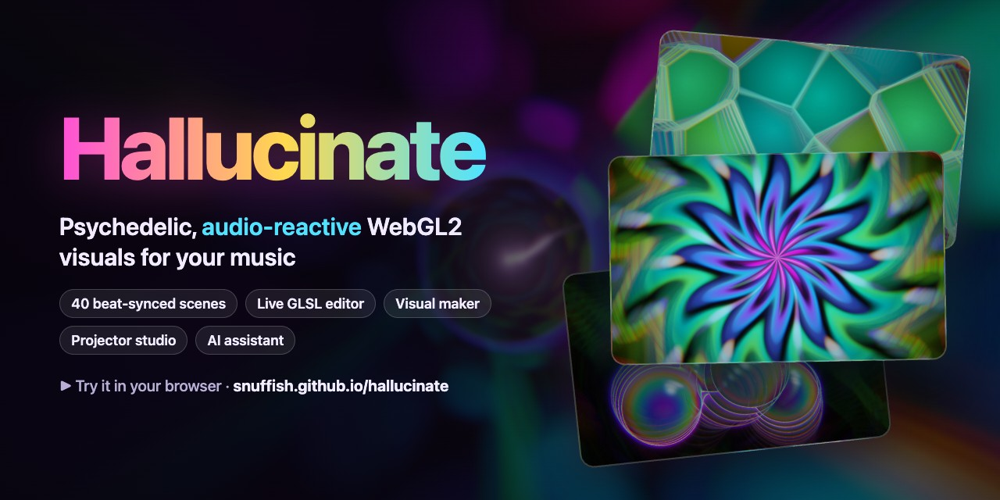
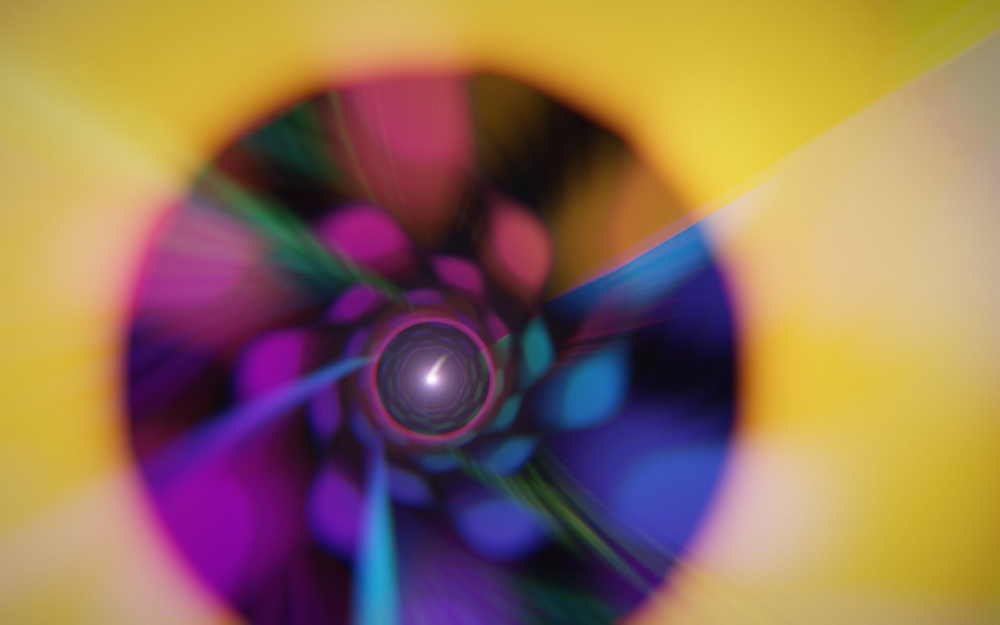
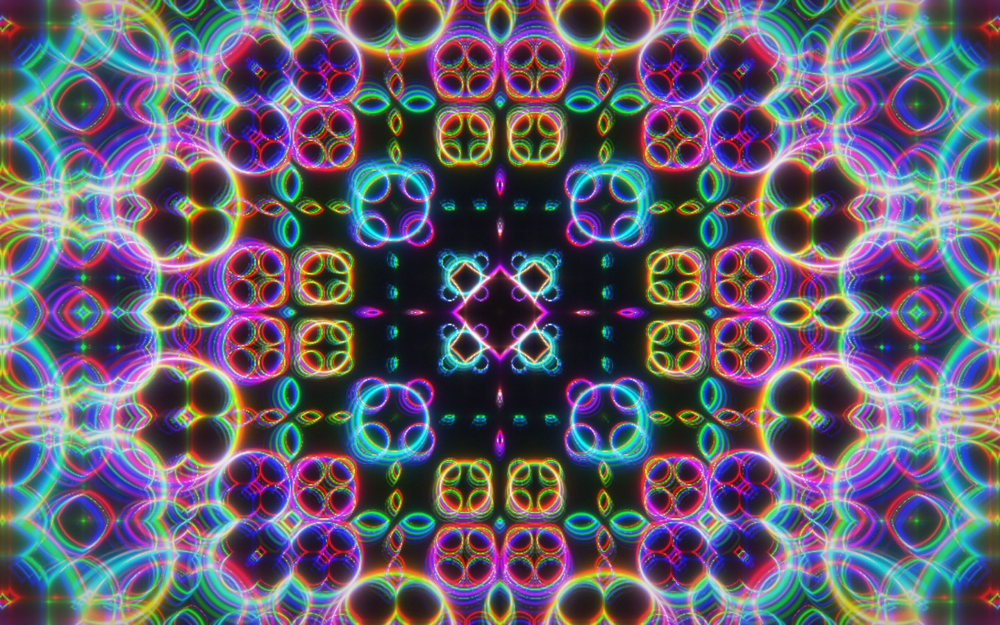
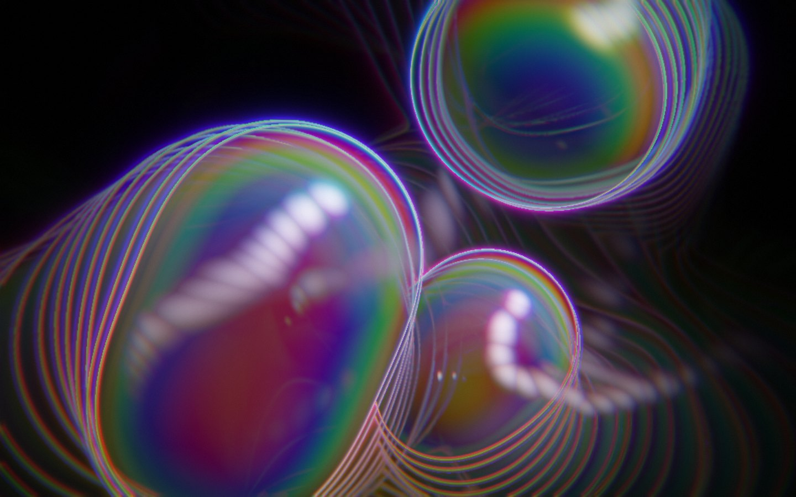
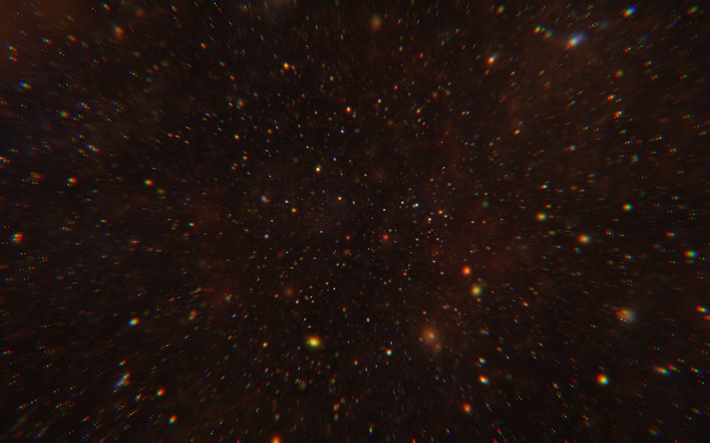
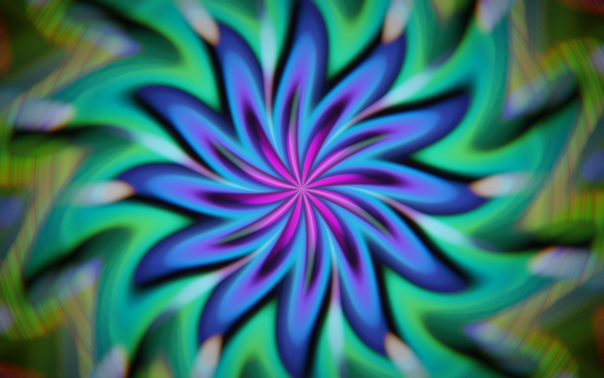
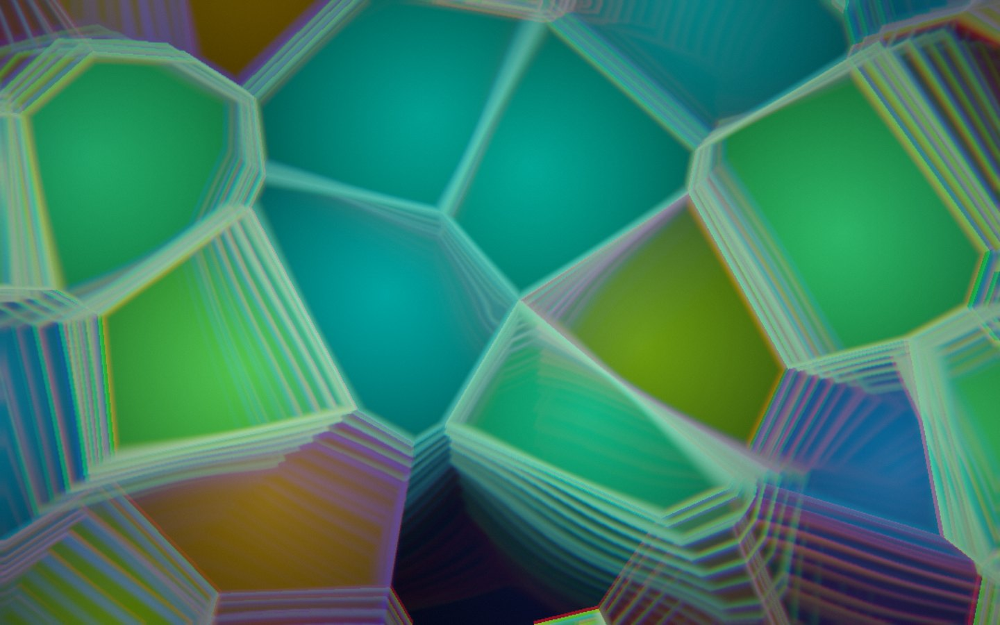
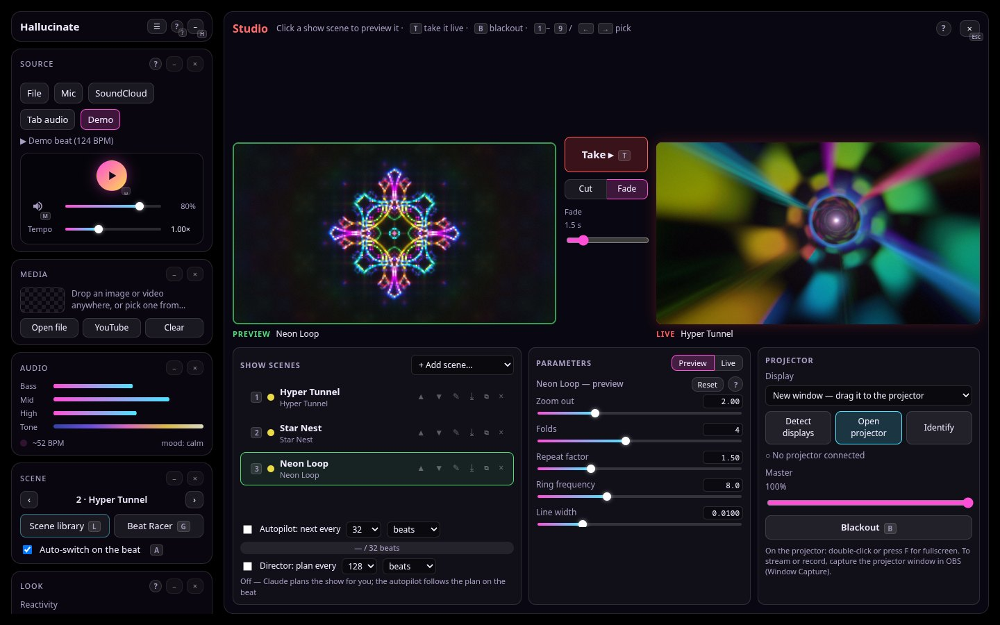
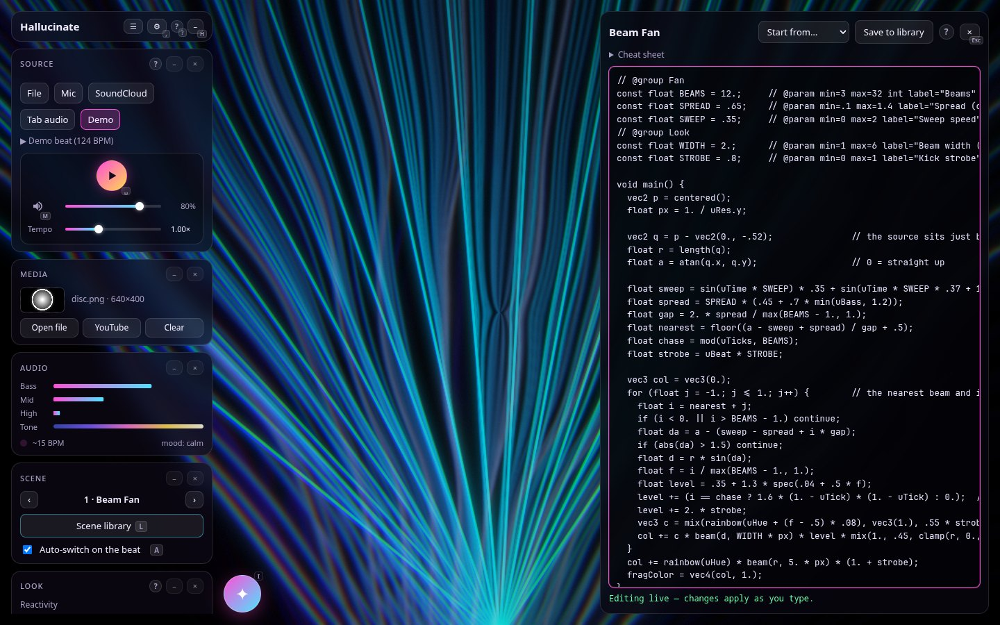

<h1 align="center">
  <a href="https://snuffish.github.io/hallucinate/"></a>
  <br>
  Hallucinate
</h1>

<p align="center">
  <b>Psychedelic, audio-reactive visuals for your music, rendered in real time with WebGL2 shaders.</b><br>
  40 scenes that follow the beat · a live GLSL editor · a node-based visual maker · an OBS-style studio with projector output ·<br>
  a beat-driven game · an AI assistant that writes and fixes scenes for you, inside the app.
</p>

<p align="center">
  <a href="https://snuffish.github.io/hallucinate/"><b>▶ Try it in your browser</b></a> — the web demo has everything except SoundCloud, YouTube, the AI
  assistant and the studio's AI Director, which need the local server (<code>npm run dev</code>).
</p>

<p align="center">
  <a href="https://snuffish.github.io/hallucinate/"></a>
  
  
  
  
  
  
  <a href="https://github.com/snuffish/hallucinate/actions/workflows/ci.yml"></a>
  <a href="LICENSE"></a>
</p>

## 🚀 Quick start

```sh
npm install
npm run dev      # → http://localhost:5173
npm run desktop  # or run it as a desktop app (Electron)
```

Needs Node 22.12 or newer. SoundCloud and YouTube also need [yt-dlp](https://github.com/yt-dlp/yt-dlp) (and ffmpeg),
and the AI assistant needs a Claude subscription or an Anthropic API key ([setup](docs/assistant.md#setup)).
Press **?** in the app for help and every shortcut.

## ✨ At a glance

<table>
  <tr>
    <td align="center"><br><sub><b>Hyper Tunnel</b> · endless twisting tiled tunnel</sub></td>
    <td align="center"><br><sub><b>Neon Loop</b> · repeated space folding with neon glow</sub></td>
    <td align="center"><br><sub><b>Liquid Blobs</b> · metaballs that melt with the bass</sub></td>
  </tr>
  <tr>
    <td align="center"><br><sub><b>Star Nest</b> · volumetric flight through a Kali fractal</sub></td>
    <td align="center"><br><sub><b>Mandala Bloom</b> · petals and rings that bloom with the mids</sub></td>
    <td align="center"><br><sub><b>Voronoi Glass</b> · stained-glass cells that flash on the beat</sub></td>
  </tr>
</table>

<sub>Stills from a software-rendered headless browser (`scripts/screenshots.mjs`); on a GPU the scenes run at full frame rate with motion trails.</sub>

## 🎛 Features


| | Feature | |
| --- | --- | --- |
| 🎧 | **[Audio](docs/audio.md)** | Play a file, SoundCloud, the mic, a browser tab or the built-in demo beat. A full player with tempo, and *synesthesia* that colours the visuals by how the music sounds. |
| 🎬 | **[Scenes](docs/scenes.md)** · L | 40 scenes in seven categories that crossfade on the beat, a searchable library with favourites, and **Beat Racer** (G), a game driven by your music. |
| 🧑‍💻 | **[Code editor](docs/editor.md)** · E | Edit any scene's GLSL live, with errors shown as you type. Tag a value with `// @param` and it becomes a slider (P). |
| 🧩 | **[Visual maker](docs/visual-maker.md)** · N | Build scenes by wiring blocks together, then send the result to code. |
| 🖼️ | **[Media](docs/media.md)** | Drop an image or video, or pick one from YouTube, and warp it with the Media scenes. |
| 📺 | **[Studio & projector](docs/studio.md)** · O | An OBS-style Preview / Live studio with projector windows, fades, an autopilot that counts beats, and an AI Director that plans the set. |
| ✦ | **[AI assistant](docs/assistant.md)** · I | Claude writes and fixes scenes, sets parameters and runs the studio for you, across several conversations. |
| 🪟 | **[Interface](docs/interface.md)** | Dockable, resizable widgets with a remembered layout, and help on every panel. |
| 💾 | **[Back up](docs/backup.md)** | Export everything you made to one file and import it elsewhere. |
| 🖥 | **[Desktop app](docs/desktop.md)** | The whole app in its own window, with installers for macOS, Windows and Linux on the [releases page](https://github.com/snuffish/hallucinate/releases). |

More: [keyboard shortcuts](docs/keys.md) · [development & project structure](docs/development.md) ·
[ARCHITECTURE.md](ARCHITECTURE.md) · [PERF.md](PERF.md) · [CHANGELOG.md](CHANGELOG.md)

<table>
  <tr>
    <td align="center"><br><sub><b>Studio</b> · Preview, Live and projectors</sub></td>
    <td align="center"><br><sub><b>AI assistant</b> · scenes and shows on request</sub></td>
  </tr>
  <tr>
    <td align="center"><br><sub><b>Code editor</b> · live GLSL</sub></td>
    <td align="center"><br><sub><b>Visual maker</b> · scenes from blocks</sub></td>
  </tr>
</table>

## 📄 License

[MIT](LICENSE). Audio and video fetched through yt-dlp stay under their owners' terms; see [Audio sources](docs/audio.md#audio-sources).
