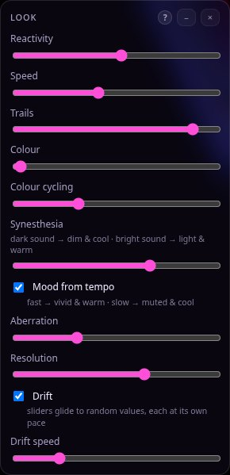
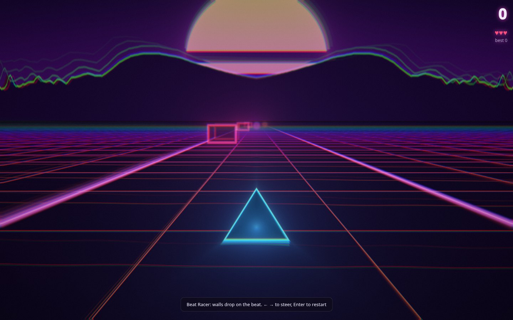
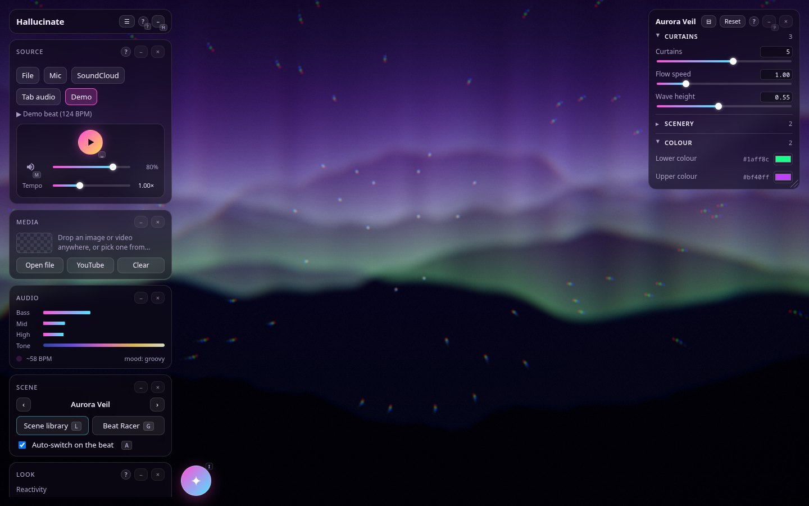

<h1 align="center">
  <a href="https://snuffish.github.io/hallucinate/"></a>
  <br>
  Hallucinate
</h1>

<p align="center">
  <b>Psychedelic, audio-reactive visuals for your music, rendered in real time with WebGL2 shaders.</b><br>
  40 scenes that follow the beat · a live GLSL editor · a node-based visual maker · an OBS-style studio with projector output ·<br>
  a beat-driven game · an AI assistant that writes and fixes scenes for you, inside the app.
</p>

<p align="center">
  <a href="https://snuffish.github.io/hallucinate/"><b>▶ Try it in your browser</b></a> — the web demo has everything except SoundCloud, YouTube and the AI
  assistant, which need the local server (<code>npm run dev</code>).
</p>

<p align="center">
  <a href="https://snuffish.github.io/hallucinate/"></a>
  
  
  
  
  
  
  <a href="https://github.com/snuffish/hallucinate/actions/workflows/ci.yml"></a>
  <a href="LICENSE"></a>
</p>

```sh
npm install
npm run dev      # → http://localhost:5173 (localhost only; HOST=0.0.0.0 exposes it, PORT changes the port)
npm run build    # → dist/
npm run preview  # serve the built app (the SoundCloud / YouTube bridges and the assistant work here too)
npm run desktop  # the same app as a desktop window (Electron); see Desktop app
```

Needs Node 22.12 or newer.

Every button with a shortcut shows its key as a small badge, and the badge lights up while you hold a
modifier. The full list is at the bottom of the panel and in [Keys](#%EF%B8%8F-keys).

## Contents

- [At a glance](#-at-a-glance)
- [Audio sources](#-audio-sources) · [Audio player](#-audio-player) · [Synesthesia](#-synesthesia-sound--light-mapping)
- [Scenes](#-scenes) · [Scene library](#-scene-library--press-l) · [Beat Racer](#-beat-racer-game--press-g)
- [Code your own](#-code-your-own--press-e) · [Live parameters](#-live-parameters--press-p) · [Visual maker](#-visual-maker--press-n)
- [Media](#%EF%B8%8F-media--drop-an-image-or-video) · [Studio & projector](#-studio--projector--press-o) · [AI assistant](#-ai-assistant--press-i)
- [Back up & move your setup](#-back-up--move-your-setup) · [Keys](#%EF%B8%8F-keys) · [How it works](#%EF%B8%8F-how-it-works) · [Development](#%EF%B8%8F-development) · [Desktop app](#-desktop-app) · [Web demo](#-web-demo) · [License](#-license)

## ✨ At a glance

<table>
  <tr>
    <td align="center"><br><sub><b>Hyper Tunnel</b> · endless twisting tiled tunnel</sub></td>
    <td align="center"><br><sub><b>Neon Loop</b> · repeated space folding with neon glow</sub></td>
    <td align="center"><br><sub><b>Liquid Blobs</b> · metaballs that melt with the bass</sub></td>
  </tr>
  <tr>
    <td align="center"><br><sub><b>Star Nest</b> · volumetric flight through a Kali fractal</sub></td>
    <td align="center"><br><sub><b>Mandala Bloom</b> · petals and rings that bloom with the mids</sub></td>
    <td align="center"><br><sub><b>Voronoi Glass</b> · stained-glass cells that flash on the beat</sub></td>
  </tr>
</table>

<sub>Stills from a software-rendered headless browser (`scripts/screenshots.mjs`); on a GPU the scenes run at full frame rate with motion trails.</sub>

## 🎧 Audio sources


- **File** – click *Open audio file* or drag & drop any mp3/wav/flac/ogg/m4a onto the page.
- **SoundCloud** – search SoundCloud, or paste a track / playlist / artist link, and click a result.
  The picker opens on your *recently played* tracks (last 25; *Recent* brings the list back, *Clear history*
  forgets it), so you can replay one without searching again. Results play in order like a queue. Needs
  [yt-dlp](https://github.com/yt-dlp/yt-dlp) installed (`sudo pacman -S yt-dlp` or `pip install yt-dlp`): the local
  server fetches the track into a temp cache (`$TMPDIR/hallucinate-soundcloud`) so the browser can analyse it, which
  SoundCloud's own embedded player doesn't allow. Some tracks (SoundCloud Go+ / region-locked) can't be fetched.
  For personal use; respect artists' rights.
- **Microphone / line-in** – reacts to whatever the mic hears.
- **Tab / system audio** – share a browser tab (Spotify web, YouTube, SoundCloud…) or your screen and tick
  *Share audio* (Chromium-based browsers).
- **Demo beat** – a built-in synthesised techno loop.

## ⏯ Audio player

Files and SoundCloud tracks get a player in the panel: seek bar, play/pause, ±10 s, previous / next track
(SoundCloud results act as the queue; ⏮ restarts the track after 3 s), loop, volume and mute, and **tempo**
from 0.5× to 2× (click the value or double-click the slider to reset). By default tempo keeps the pitch;
tick *Pitch follows tempo* for a vinyl / nightcore effect. The demo beat gets play/pause, volume and tempo (its BPM).
Volume is applied after the analyser, so the visuals react the same at any listening volume, even when muted.

## 🌈 Synesthesia (sound ↔ light mapping)



Based on crossmodal-correspondence research (people reliably pair loud ↔ bright, high/bright timbre ↔ light and
warm, low/muffled ↔ dark and cool, fast/energetic music ↔ saturated warm colours).

- **Tone** – the spectral centroid (loudness-weighted average frequency) mapped from ~1.1 kHz (dark: piano,
  ambient) to ~5.5 kHz (bright: hi-hat-heavy house, psytrance) and smoothed over a few seconds. Shown in the panel.
- **Mood** – tempo (80 → 160 BPM) plus overall energy, smoothed over ~4 s. Toggle with *Mood from tempo*.
- **Synesthesia slider** – how strongly they grade every scene: dark sound → dimmer, cooler, hazier, longer trails;
  bright sound → lighter, warmer, crisper, more colour fringing; energetic mood → more saturated and warmer.
- Both values are also available to your own shaders (`uBright`, `uMood`) and as *tone* / *mood* outputs on the
  visual maker's Audio block.
- **Drift** (Look widget) – the Look sliders glide to new random values on their own, each at its own pace, so the
  look keeps changing smoothly; *Drift speed* sets how fast. *Randomize* (R) jumps instead, and Shift+R steps back.

## 🎬 Scenes

40 visual scenes in seven categories (Fractal · Tunnel & 3D · Geometric · Organic · Spectrum · Space · Media). Every
scene has live parameters suited to it — speeds, counts, sizes, colours and on/off layers (press P); their defaults are
the scene's original look:
Kaleido Fractal · Hyper Tunnel · Mandala Bloom · Liquid Plasma · Gyroid Cave · Wave Orbits · Julia Morph · Voronoi Glass · Hex Pulse ·
Aurora Veil · Radial EQ · Oscilloscope · Truchet Weave · Moiré Bloom · Hyperspace · Menger Halls · Flower of Life ·
Quasicrystal · Tumbling Blocks · Polygon Tunnel · Op Art Lens · Tesseract · Spirograph ·
Lissajous Knot · Mirror Kaleidoscope · Retro Plasma · Starfield · Sunburst · Lava Lamp · the seven Media scenes below,
plus four written from techniques made famous on Shadertoy (own implementations, not copied code):

| Scene | Technique | Inspired by |
| --- | --- | --- |
| Neon Loop | repeated `fract()` folding + inverse-distance neon glow | kishimisu, *An introduction to Shader Art Coding* |
| Star Nest | volumetric march through a tiled 3D Kali fractal | Kali, *Star Nest* |
| Neon Jacks | glow accumulation while raymarching repeated shapes | *Phantom Star* / *Octagrams* style |
| Liquid Blobs | smooth-min metaballs; bass melts them, spectrum sizes them | *Audio Reactive Liquid Blobs* |

With *Auto-switch* on, scenes crossfade every 32 detected beats (or 45 s), picking from the scenes in rotation.

## 📚 Scene library — press L


Every scene as a card with a rendered preview. Filter by category or search, then click a preview to play it.

- **★ Favourite** – favourites come up twice as often in auto-switch.
- **Auto-switch** checkbox – take a scene out of (or back into) the rotation.
- **Edit code** – opens the scene's source in the code editor to remix.
- In the code editor, **Save to library** stores your shader as a scene (category *Mine*). It joins the rotation,
  survives reloads, and can be overwritten by saving under the same name or deleted from its card.

Keyboard, with the library open: `/` jumps to the search box (`Esc` leaves it, a second `Esc` closes the library),
`Tab` / `Shift+Tab` cycle the categories, `←` `↑` `↓` `→` move through the hits (also while typing), `Enter` plays the
highlighted scene, `1`–`9` and `0` play the first ten scenes as everywhere else.

## 🏁 Beat Racer (game) — press G



A synthwave racer driven by your music: walls drop on every detected beat, the mountains are the live spectrum.
Steer with ← / →, dodge walls (+1 × multiplier), grab orbs (+10 × multiplier). The multiplier grows every 8 in a row;
3 lives; Enter restarts. Best score is remembered.

## 🧑‍💻 Code your own — press E


Opens the code of **the scene that's playing** in a live GLSL editor, and edits it in place. It recompiles as you type
— in the background, so the visuals never freeze — shows errors with line numbers (the last working version keeps
running), and saves automatically in the browser. While it's open the editor follows the scene on screen
(← / →, the library…) and auto-switch holds still.

- **Built-in scenes:** your edits are kept as your version of the scene (its library card says *edited by you*);
  *Revert to original* brings the original back.
- **Your library scenes** save straight back to the library. **My Shader** is your scratch scene.
- **Visual-maker scenes** are generated from the graph, so they open read-only; *Edit a copy* puts the code in My Shader.
- *Start from…* replaces the code with a blank template or any built-in scene's original; *Save to library* saves the
  code as a new scene. The *Cheat sheet* lists the audio uniforms and helpers. In the library, *Edit code* plays a scene
  and opens it here.

## 🎛 Live parameters — press P



Expose values and constants as controls in an overlay on the scene, and tweak them while it runs (no recompiling).
In the code editor, tag a top-level `uniform` or `const` with `// @param`:

```glsl
uniform float uGlow;                 // @param min=0 max=3 default=1 label="Glow"
const float RINGS = 30.;             // @param min=5 max=80 int
const vec3 TINT = vec3(1., .3, .8);  // @param color
uniform bool uMirror;                // @param default=true
uniform vec2 uCentre;                // @param min=-.5 max=.5
```

Types: `float` (slider + number), `bool` (checkbox), `vec2`/`vec3`/`vec4` (a slider per component, or a colour picker
with `color`). Options: `min max step default label int color group`. A `// @group Name` line puts the controls after it
under a heading that starts folded and opens with a click (until the next `@group`; a bare `// @group` ends grouping), which keeps a long list tidy. In the visual maker, use the **Slider** and
**Colour picker** blocks — they become the same annotated uniforms, so *Send to code* and *Save to library* keep them.
Values are remembered per scene; if you change a `default` in the code, the new default takes over. Double-click a slider
to reset it, *Reset* resets them all, P collapses the overlay. Drag the overlay by its title bar to put it anywhere (it
remembers the spot); double-click the title bar to send it back to the corner. It appears once a source plays; inside
the studio it's a dock.

## 🖼️ Media — drop an image or video

Drop any image (png, jpg, gif, webp…) or video (mp4, webm, mov…) on the page, or use *Open file* in the panel's
Media section. Every scene can sample it; the **Media** scenes are built for it, each with live parameters:

| Scene | What it does |
| --- | --- |
| Media Kaleidoscope | mirrors it into 0–16 segments, zoom / spin |
| Media Liquid | flowing noise warp, colour split, optional swirl |
| Media Glitch | datamosh-style row shifts, RGB split, corrupted blocks, scanlines; bursts on the beat |
| Media Halftone | print-style dots (ink on paper, or colour dots) |
| Media Ripple | water ripples from a movable drop point |
| Media Droste | endless zoom into copies of itself, with optional spiral arms |
| Media Neon Edges | its outlines as glowing (rainbow) neon |

**YouTube:** *YouTube* in the Media section searches YouTube (or paste a video, playlist or Shorts link) and remembers
the videos you used. The local server fetches the video with yt-dlp (up to 720p; needs ffmpeg to merge picture and
sound) into a temp cache, so the first load of a long video takes a moment and later ones are instant. Live streams
aren't supported. Downloads show live progress (percentage, size, speed, time left) in the picker and at the top of
the panel — also for SoundCloud — and × cancels; a cancelled download resumes where it stopped next time.

Videos loop, muted (the music drives the visuals). Tick **Use the video's sound as the music** (Media section or the
YouTube picker) to make a video — e.g. a music video — the audio source: the player then controls it (seek, tempo,
volume), the picture follows, and a YouTube result list continues with the next video when one ends. In code, `media(p)`
returns the picture at a centered position — it fills the screen and is mirrored beyond its edges, so warped coordinates
never run out — and `untone(col)` shows it in its true colours. In the visual maker use the **Media** block (see the
*Media warp* example). Projector windows get the file itself and play it in sync, at full quality.

## 📺 Studio & projector — press O


Run a show like OBS's Studio Mode and put it on a projector. The two monitors are **Preview** (green) and **Live** (red).

1. **Build the show.** *+ Add scene…* adds any library scene, or *What's on Live now* (the current scene,
   its live parameter values and the look sliders). Rename, reorder (▲▼), duplicate, and use ⤓ *Update from Live*
   to store a look you've just tweaked live.
2. **Preview → Live.** Click a show scene (or 1–9, ←/→) to put it in **Preview**, then **Take** (T) sends it to
   **Live** with a *Cut* or a *Fade* (0.2–8 s). Double-click a scene to take it straight away. Preview then moves on
   to the next scene, so you can keep pressing T.
3. **Projector.** *Detect displays* (asks once for the browser's *window management* permission, Chrome/Edge),
   pick the projector, *Open projector*, then double-click that window (or press F there) for fullscreen.
   The projector renders the show itself at its own resolution — it isn't a scaled-down video — and follows
   live code / visual-maker edits. *Identify* shows each projector's resolution on it. Without display access, open it
   as a normal window and drag it onto the projector.
4. **Master / Blackout** (B) fades Live and every projector to black and back, over the fade time.
5. **Autopilot** steps through the show every 16 / 32 / 64 / 128 beats (random auto-switch pauses while it's on).
   A bar under it counts the beats gone and left until the next take. These beats come from a tempo clock: it takes
   its speed from the BPM detected on the kick drum, re-anchors on every real kick, and keeps counting through
   breakdowns and silence, so the show moves on even when the bass stops. (Everything else that reacts "on the beat",
   the `uBeat` uniform, auto-switch and Beat Racer, follows the detected kicks themselves.) For music without a usable
   beat (ambient, a talk, a film), switch the unit box from *beats* to *seconds*: the autopilot then runs on a plain
   timer, every 10 s … 5 min, with or without music, and every plan step gets the same time.
6. **Close the studio and keep browsing.** Once a show scene is Live, closing the studio pins it: projectors keep
   rendering the Live scene while whatever you do on screen (switch scenes, tweak sliders) is only a preview. The panel
   shows *● LIVE · name* meanwhile; `T` still takes the next Preview scene straight to Live. Reopening the studio puts
   Live back on screen.
   The **Screen** widget switches this screen between your **Preview** and **● Live** without opening the studio: Live
   shows exactly what the projectors get (Live's scene, parameters and look), and the scene you browsed to stays the
   preview for when you switch back.
7. **Plans and the Director.** Instead of list order, the autopilot can follow a **plan**: an ordered queue of show
   scenes, each with its own beat count and transition. Plans come from the [AI assistant](#-ai-assistant--press-i)
   ("build a 30-minute set that starts calm and peaks at the end") or from **Director** mode: tick *Director: plan
   every 64 / 128 / 256 beats* (or, with the unit box on *seconds*, every 30 s … 10 min on a timer) and Claude reads a
   short digest of the music (tempo, mood, tone, the energy of the last few cycles) and the show, writes the next
   steps, and the autopilot takes them on the bar. On beats it also plans at least every two minutes, tempo or not. The plan shows as chips
   under the beat bar (the red one is playing; click one to preview it, ↶ brings the previous plan back, × drops it);
   the line below says what the director last decided and how many beats until its next cycle. Every step also has a
   wall-clock ceiling (90 s by default) so the show moves on even when no tempo has been detected yet. A take or an edit
   by hand is reported to the director in its next cycle and it respects it; the director never takes Live by itself and
   never edits scene code. Each cycle is a fresh, short conversation (the app remembers the recent decisions), so a long
   set costs the same per cycle at the end as at the start; the token count so far is in the status line.

While the studio is open the main canvas is the Live monitor and the Parameters overlay becomes a dock. Like OBS's
Studio Mode, the dock edits the **selected (Preview) show scene** by default — tweaks show on the Preview monitor, are
saved in that show scene and go live when you Take it — and its *Live* tab edits what's live. The show is
saved in the browser. The projector must run in the same browser on the same computer (e.g. an extended display);
keep the main window open (not minimised) — it drives the projector. To stream or record, capture the projector window
in OBS (*Window Capture*), or use *Record* here.

## ✦ AI assistant — press I


A chat bubble at the bottom, next to the panel (✦, or I) that opens a panel where Claude creates and edits scenes for you, right in the app, while everything else stays where it is: it reads a scene's
code, writes or fixes it (and sees its own compile errors), creates new scenes in your library, sets live parameters
and the look sliders, switches scenes, and looks at a rendered frame to check its work. It also runs the
[studio](#-studio--projector--press-o): it adds, changes, reorders and removes show scenes, sets the transition and the
autopilot, writes a plan for the autopilot and takes show scenes live ("build a show from the Space scenes and plan an
hour", "swap the next two scenes", "longer fades"). Every change shows up live, and
**Undo** in the panel reverts the assistant's newest change (edits, new scenes, parameters, look, show), and Claude is
told with your next message; built-in scenes can also be reverted to their original in the code editor. **Stop**
interrupts it. After each reply the assistant suggests three things you could ask next, as buttons under the reply,
like the examples on an empty chat.

- **Several conversations at once.** **New** starts another while the others keep working; the title at the top opens
  the list (working ones first, then pinned, then by day) with search (`Ctrl/⌘ K`), rename, pin, export as Markdown
  and delete; `Alt ↑ / ↓` steps through them. They are kept in this browser (IndexedDB; the 50 newest, pinned ones
  stay), so they survive a reload. On the subscription backend at most three run at once; a fourth waits its turn.
- **Notifications.** Close the panel while Claude works: the bubble's ring turns, then a badge counts the
  conversations with a reply waiting and a card next to the bubble peeks at it (click it to open that conversation).
  With the tab in the background, the window title shows the count.
- **Token usage** under each reply (in, out, how much came from the prompt cache) and for the whole conversation;
  long conversations get a hint to start a new one. On a subscription the tooltip also shows the CLI's API-equivalent
  cost (not billed).
- **Reasoning.** 💭 shows Claude's reasoning (rendered, with a word count and Copy) or folds it away; the setting is
  remembered.
- **Type while it works**: your message waits (dimmed, × to drop it) and goes out when the reply is done. **Retry**
  after an error; **Copy** on replies and code blocks. Drag the panel's corner to resize it (double-click for the
  natural size).

Two ways to reach Claude, picked automatically — the credentials never reach the browser:

```sh
# With a Claude subscription: install Claude Code (the `claude` command), sign in once, then simply
npm run dev

# With an Anthropic API key (billed to your account):
export ANTHROPIC_API_KEY=sk-ant-…
npm run dev
```

On the subscription backend Claude Code runs with **no built-in tools, none of your settings and a throw-away working
directory**: it can only use this app's tools (eight for scenes, nine for the studio). Optional: `ASSISTANT_MODEL`
(default `claude-opus-5-5` on the API; the CLI's default otherwise), `ASSISTANT_EFFORT` (`low` … `max`, default `high`;
lower is faster and cheaper), `ASSISTANT_DIRECTOR_EFFORT` (the effort of the studio director's cycles; same as
`ASSISTANT_EFFORT` unless set), `ASSISTANT_BACKEND=api|claude-code` to force one, `ASSISTANT_DEBUG=1` to log the CLI
arguments and tool traffic. The director's cycles get only the show tools (read the show, write the plan, tweak a show
scene's look); on the subscription backend each cycle is one short `claude` run and its session is dropped afterwards.
On the API backend the system prompt and tool list are cached between runs.

## 🧩 Visual maker — press N


Build scenes by wiring blocks together instead of writing code. Pick blocks from the left
(Input · Coordinates · Pattern · Math · Color), drag from an output ● to an input ● to connect them, and type
numbers straight into unconnected inputs. The result renders live behind the graph (*Peek* hides the graph).
Wires are colour-coded by type (white = number, cyan = position, pink = colour); mismatched types are converted
automatically. *Examples…* loads ready-made graphs, and *Send to code* turns the graph into GLSL in the code editor
so you can keep going by hand. Graphs save automatically. `Delete` removes the selected block.

## 💾 Back up & move your setup

**☰ → Export scenes & settings** saves everything you made and set up to one `.json` file: your saved scenes, your
edits to built-in scenes, *My Shader*, the visual maker graph, live parameter values, the Studio show (cues, plan,
autopilot and director settings), favourites and the auto-switch rotation, volume and *pitch follows tempo*, the
widget layout and *Use the video's sound*. It doesn't include recently played tracks, the Beat Racer high score, the
loaded media, or the Look sliders, which aren't saved between sessions anyway.

**☰ → Import…** (or drop the `.json` file on the page) replaces those with the file's and reloads the app. Before
anything changes, your current setup is downloaded as `hallucinate-before-import-….json`, so an import can always be
undone by importing that file. Sections missing from the file stay as they are. A file that doesn't check out (made by a
newer version, or edited by hand into something invalid) is refused and nothing is changed. Other open Hallucinate tabs
reload with the import, so they can't write their old state back.

Shaders that don't compile on this computer (another GPU or driver, or a different app version) aren't lost: the
library lists them under **Doesn't compile here**, where *Fix in editor* loads one into *My Shader*; save it to the
library under the same name once it works. They stay saved, and in your exports, until you delete them.

## ⌨️ Keys

| Key | Action |
| --- | --- |
| Space | play / pause |
| Shift + ← / → | seek −10 s / +10 s |
| ↑ / ↓ | volume |
| [ / ] | tempo −5 % / +5 % |
| M | mute |
| ← / → , 1–9, 0 | change scene (← / → steer in the game) |
| L | scene library (inside: `/` search, Tab categories, arrows move, Enter play) |
| I | AI assistant (inside: Alt+N new conversation, Alt+↑ / ↓ switch, Ctrl/⌘+K find one) |
| O | studio & projector (inside: 1–9 / ← → preview, T take, Esc close) |
| T | take Preview live |
| B | blackout / restore |
| P | collapse / expand the Parameters overlay |
| G | Beat Racer |
| E | shader editor |
| N | visual maker (node graph; Delete removes a block) |
| A | toggle auto-switch |
| R | randomize the look (also the scene with *Randomize also picks a random scene* ticked) |
| Shift+R | back to the look before the last randomize (again to step further back) |
| C | start / stop recording (downloads a .webm with audio) |
| F | fullscreen |
| H | hide panel (also auto-hides after 3 s of no mouse movement) |
| Esc | close the open panel (in the library: leave the search field first) |

Sliders: reactivity, speed, trails (feedback), colour, colour cycling, chromatic aberration and render resolution (lower it if frames drop).

## 🏗️ How it works

See [ARCHITECTURE.md](ARCHITECTURE.md) for the structure, the invariants and how to add scenes, blocks, tools and
shortcuts; [PERF.md](PERF.md) for the performance work and measurements; [CHANGELOG.md](CHANGELOG.md) for what changed
in the React port. In short:

- `src/engine/` – the engines (WebGL pipeline, audio analysis, scenes, `@param` parsing, visual-maker compiler, media, game, projector link), plain TypeScript classes.
- `src/app/` – the controller that owns them and the frame loop, the editor / studio / player logic, the React shell.
- `src/components/` – the panels; `src/hotkeys/` – the shortcut registry and the key badge; `src/state/` – app state, UI store, persistence.
- `src/assistant/` – the assistant's tools (zod definitions, browser implementations, undo), its conversations and their history.
- `server/` – the yt-dlp bridges, the TanStack AI chat route, the two Claude backends and the system prompt.
- `src/output.ts` / `output.html` – projector windows.

Adding a scene = add a `scene(name, category, description, glsl)` line to `SCENES` in `src/engine/scenes.ts`.

## 🛠️ Development

```sh
npm run lint        # ESLint (TypeScript + React hooks rules)
npm run typecheck   # tsc for the app and the server
npm test            # Vitest unit tests (parameters, node compiler, scene list, hotkeys, persistence, assistant plumbing)
npm run test:e2e    # Playwright: boot, scenes, every panel, library keyboard navigation
npm run test:e2e:desktop   # builds the desktop app and drives it (needs a GPU, so not in CI)
ASSISTANT_E2E=1 npx playwright test e2e/assistant.spec.ts   # one real assistant round-trip (uses your Claude backend)
node perf/measure.mjs http://localhost:5173/ perf/results/<name>.json   # performance probe, with the dev server running
```

## 🖥 Desktop app

Hallucinate also runs as a desktop app, built with [Electron](https://www.electronjs.org/). Everything works in it,
including SoundCloud, YouTube, the AI assistant and the Director: the app starts the same local server the dev server
provides and opens the app in its own window, so no terminal or browser is needed.

```sh
npm run desktop       # develop: the desktop window on the Vite dev server, with hot reload
npm run package:dir   # build the app unpacked into release/ (quick to try: release/mac-arm64/Hallucinate.app)
npm run package       # build the installer for this OS into release/ (.dmg + .zip, .exe, or .AppImage)
```

Installers for macOS, Windows and Linux are also built by [`.github/workflows/release.yml`](.github/workflows/release.yml)
on a `v*` tag (or by hand from the Actions tab) and attached to the run.

- **Unsigned.** The builds aren't code-signed. On macOS, open the app the first time with right-click → *Open*; Windows
  SmartScreen asks once too.
- **`claude`, `yt-dlp` and `ffmpeg`** are found through your login shell's `PATH`, also when the app is started from the
  Dock or a menu. `CLAUDE_BIN` and `YTDLP` still point at a specific binary, and `ANTHROPIC_API_KEY` in your shell
  profile selects the API backend.
- **Your data** (scenes, shows, settings, assistant conversations) lives in the app's own profile, separate from the
  browser's and from `npm run desktop`'s. Move a setup between them with *☰ → Export scenes & settings* and *Import…*.
  The app serves itself on `http://127.0.0.1:47741`; if that port is taken it says so and runs on another one, without
  your saved data, until the port is free again.
- **System audio** (*Tab / system audio*): on Windows it captures everything playing. On macOS it opens the system's
  screen-sharing picker; whether sound comes along depends on the macOS version. On Linux, Electron can't capture system audio; use the
  microphone / line-in or a loopback device instead.
- **Projectors** work as in Chrome: *Detect displays* lists the screens without asking, and projector windows are
  ordinary app windows.

## 🌐 Web demo

**[https://snuffish.github.io/hallucinate/](https://snuffish.github.io/hallucinate/)** runs the app straight from GitHub Pages. Everything that runs in the
browser works: audio files, mic, tab audio, the demo beat, all scenes, the editor, the visual maker, the studio with
projector windows, and Beat Racer. SoundCloud, YouTube, the AI assistant and the studio director need the local server, so
the demo hides them or points you to `npm run dev`.

It is deployed by [`.github/workflows/pages.yml`](.github/workflows/pages.yml) on every push to `main`. To build the same
thing locally:

```sh
VITE_STATIC_DEMO=1 BASE_PATH=/hallucinate/ npm run build   # → dist/, served from /hallucinate/
```

## 📄 License

[MIT](LICENSE). Audio and video fetched through yt-dlp stay under their owners' terms; see [Audio sources](#-audio-sources).
