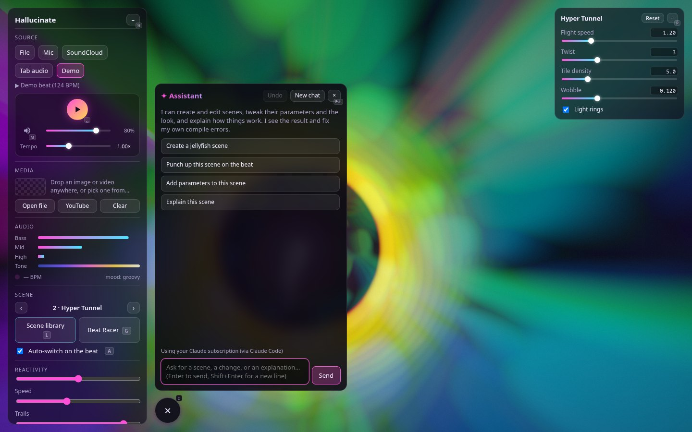

# ✦ AI assistant — press I

[← Back to the README](../README.md)



A chat bubble at the bottom, next to the panel (✦, or I), opens a panel where Claude creates and edits scenes for you,
right in the app, while everything else stays where it is. It:

- reads a scene's code, writes or fixes it (and sees its own compile errors), and creates new scenes in your library;
- sets live parameters and the look sliders, switches scenes, and looks at a rendered frame to check its work;
- runs the [studio](studio.md): it adds, changes, reorders and removes show scenes, sets the transition and the
  autopilot, writes a plan for the autopilot and takes show scenes live ("build a show from the Space scenes and plan an
  hour", "swap the next two scenes", "longer fades").

Every change shows up live. **Undo** in the panel reverts the assistant's newest change (edits, new scenes, parameters,
look, show), and Claude is told with your next message; built-in scenes can also be reverted to their original in the
[code editor](editor.md). **Stop** interrupts it. After each reply the assistant suggests three things you could ask
next, as buttons under the reply, like the examples on an empty chat.

## Features

- **Several conversations at once.** **New** (Alt+N) starts another while the others keep working; the title at the
  top opens the list (working ones first, then pinned, then by day) with search (`Ctrl/⌘ K`), rename, pin, export as
  Markdown and delete; `Alt ↑ / ↓` steps through them. They are kept in this browser (IndexedDB; the 50 newest, pinned
  ones stay), so they survive a reload. On the subscription backend at most three run at once; a fourth waits its turn.
- **Notifications.** Close the panel while Claude works: the bubble's ring turns, then a badge counts the
  conversations with a reply waiting and a card next to the bubble peeks at it (click it to open that conversation).
  With the tab in the background, the window title shows the count.
- **Token usage** under each reply (in, out, how much came from the prompt cache) and for the whole conversation;
  long conversations get a hint to start a new one. On a subscription the tooltip also shows the CLI's API-equivalent
  cost (not billed).
- **Reasoning.** 💭 shows Claude's reasoning (rendered, with a word count and Copy) or folds it away; the setting is
  remembered.
- **Type while it works**: your message waits (dimmed, × to drop it) and goes out when the reply is done. **Retry**
  after an error; **Copy** on replies and code blocks. Drag the panel's corner to resize it (double-click for the
  natural size).

## Setup

The assistant needs the local server (`npm run dev`, `npm run preview` or the [desktop app](desktop.md)). There are
two ways to reach Claude, picked automatically — the credentials never reach the browser:

```sh
# With a Claude subscription: install Claude Code (the `claude` command), sign in once, then simply
npm run dev

# With an Anthropic API key (billed to your account):
export ANTHROPIC_API_KEY=sk-ant-…
npm run dev
```

In the [desktop app](desktop.md) you can also paste the key into **Settings → Assistant** instead: it is encrypted
with your system's keychain, kept in the app's profile and never shown again.

On the subscription backend Claude Code runs with **no built-in tools, none of your settings and a throw-away working
directory**: it can only use this app's tools (eight for scenes, nine for the studio).

## Settings and environment variables

**Settings → Assistant** (⚙ or `,`) sets the connection, the model and the efforts, and shows which way Hallucinate
reaches Claude right now. A change applies to the next reply, without a restart. The same can be set with environment
variables; one the server was started with wins, and Settings shows that field as locked.

| Variable | Settings | What it does |
| --- | --- | --- |
| `ASSISTANT_MODEL` | Model | the model (default `claude-opus-5-5` on the API; the CLI's default otherwise, which also takes aliases like `opus`) |
| `ASSISTANT_EFFORT` | Effort | `low`, `medium`, `high`, `xhigh` or `max`, default `high`; lower is faster and cheaper |
| `ASSISTANT_DIRECTOR_EFFORT` | Director effort | the effort of the studio director's cycles; same as the effort unless set |
| `ASSISTANT_BACKEND` | Connection | `api` or `claude-code` to force one backend |
| `ANTHROPIC_API_KEY` / `ANTHROPIC_AUTH_TOKEN` | API key (desktop app) | selects the API backend |
| `CLAUDE_BIN`, `YTDLP` | shown only | the `claude` and `yt-dlp` programs to run; never settable from the page, since the server runs them |
| `ASSISTANT_DEBUG` | | `1` logs the CLI arguments and tool traffic |

Settings saved from the page live in `~/.config/hallucinate/config.json` (`%APPDATA%\hallucinate` on Windows) for
`npm run dev`, and in the app's profile for the desktop app. They can only be changed from the computer the server runs
on: with `HOST=0.0.0.0`, a device on the network sees them but can't change them.

The director's cycles get only the show tools (read the show, write the plan, tweak a show scene's look); on the
subscription backend each cycle is one short `claude` run and its session is dropped afterwards. On the API backend the
system prompt and tool list are cached between runs.
