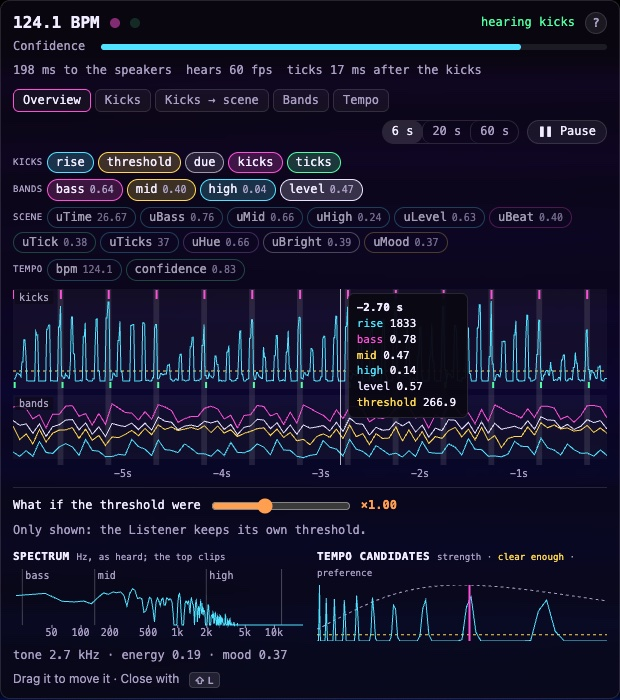

# 🎧 Audio: sources, player & synesthesia

[← Back to the README](../README.md)

## Audio sources

- **File** – click *Open audio file* or drag & drop any mp3/wav/flac/ogg/m4a onto the page.
- **SoundCloud** – search SoundCloud, or paste a track / playlist / artist link, and click a result.
  The picker opens on your *recently played* tracks (last 25; *Recent* brings the list back, *Clear history*
  forgets it), so you can replay one without searching again. Results play in order like a queue. Needs
  [yt-dlp](https://github.com/yt-dlp/yt-dlp) installed (from your package manager or `pip install yt-dlp`): the local
  server fetches the track into a temp cache (`$TMPDIR/hallucinate-soundcloud`) so the browser can analyse it, which
  SoundCloud's own embedded player doesn't allow. Some tracks (SoundCloud Go+ / region-locked) can't be fetched.
  For personal use; respect artists' rights.
- **Microphone / line-in** – reacts to whatever the mic hears.
- **Tab / system audio** – share a browser tab (Spotify web, YouTube, SoundCloud…) or your screen and tick
  *Share audio* (Chromium-based browsers). In the [desktop app](desktop.md) this depends on the OS.
- **Demo beat** – a built-in synthesised techno loop.
- **A video's sound** – see [Media](media.md#youtube).

## ⏯ Audio player

The player is a bar along the bottom of the screen, like Media Player's: a thin seek line runs along its top edge,
what's playing is on the left, and in the middle a round play button sits between loop, stop, −10 s and previous
track on one side and next track and +10 s on the other (SoundCloud results act as the queue; ⏮ restarts the track
after 3 s). The time, mute and volume are on the right. The **playback speed** chip (1.00×) opens the playback speed from 0.5× to
2× (click the value or double-click the slider to reset) and *Pitch follows speed*: by default the speed keeps the
pitch, and ticking it makes the pitch follow for a vinyl / nightcore effect. The demo beat gets play/pause, volume and
playback speed (its BPM). The bar shows while there is something to control
(not for the mic or tab audio), hides with the other controls (H, or after a few seconds idle), and docked widgets,
the assistant and toasts keep above it. Volume is applied after the analyser, so the visuals react the same at any
listening volume, even when muted.

## 👂 Hearing monitor

**Shift+L** opens the Hearing monitor over the main window (also with the studio open; never on Live or the
projectors): what the Listener hears, why it hears it that way, and what the scene gets from it. It only shows, never
changes anything. Its **?** explains each part; on a short screen it stops above the player bar and scrolls.

- **At a glance** – the tempo to a tenth of a BPM; when it was folded into 85–175, what the kicks gave too
  (*95.0 BPM (heard 190)*). **Confidence**: how clearly the kicks repeat at that tempo; it drains through a breakdown,
  while no kick confirms it. The kick and tick lights. The state: *hearing kicks*, *holding* (no kick for four ticks:
  the tempo is held and the ticks carry on) or *no tempo*. The delay from the app to the speakers as the browser
  reports it; music from the microphone or a shared tab is *heard outside the app*, so there is none to give. How
  many frames a second it hears, in red below 30: a beat is then only a few frames long, kicks go unheard and the
  tempo wanders (the headless test browser, at 8–11 fps, hears the 124 BPM demo anywhere from 85 to 153). And how
  late the ticks land after their kicks (the median over the last 6 s): about a frame at 60 fps.
- **The plot** – what you pick, on one time axis looking 6, 20 or 60 s back, newest on the right. Every signal is a
  chip with its value now: click one to show or hide it, double-click to show only it, or start from a preset
  (*Overview*, *Kicks*, *Kicks → scene*, *Bands*, *Tempo*). Each group of signals gets a lane:
  - **kicks** – the rise in the kick's bins (the Listener's own 6 s at full resolution; further back, the highest rise
    between two updates), the threshold a kick must reach (dashed), the windows where the next kick was due
    (shaded, the last 6 s), and the kicks (pink, top) against the ticks (green, bottom): a tick trailing its kick
    shows how late the tick clock re-anchors.
  - **bands** – bass, mid, high and their level as heard (each band's running average is what scenes react against).
  - **scene** – every value the scene's shader reads, from `uTime` to `uMood` (see [the editor's list](editor.md)),
    as the main screen's scene gets them: after the Look, so Reactivity scales the bands and `uBeat` up to 1.5. With
    the studio open, Live runs on its own clock and can differ.
  - **tempo** – the tempo (80–180 BPM) and the confidence.

  Hover the plot to read every shown value at that moment; **Pause** holds it still to read. **What if the threshold
  were…** draws a second threshold and marks the rise peaks it would let through in the last 6 s, against the kicks
  the Listener heard: a way to see whether kicks are missed or doubled. It only draws; the Listener keeps its own
  threshold. The signals picked and how far back are kept on this computer. The monitor keeps the last minute only
  while it is open.
- **Spectrum** – the analyser's bins as the Listener gets them, on a log-frequency axis marked in Hz (50 Hz to
  10 kHz) with the band edges (25, 140, 2000 and 12000 Hz) and the bands named. The top of the plot is where the
  analyser clips: loud kicks sit there.
- **Tempo candidates** – how strongly the kick signal repeats at each tempo from 40 to 200 BPM, scaled to its peak,
  with the strength it takes to hear a pulse at all dashed in yellow (a curve that never reaches it is noise; the
  Confidence bar gives the absolute strength), the Listener's preference for tempos around 120 dashed in grey, and
  the tempo the kicks gave marked. A half or double tempo standing as tall as the heard one is where a half- or
  double-time reading comes from.
- **Tone, energy, mood** – the spectral centroid in kHz and the two values (see below).

Drag it anywhere, by any part but its buttons, chips and slider; it opens there again next time (the spot is kept
with the widget layout, and Reset layout puts it back). A double-click puts it back in the corner, where it stacks
under the performance monitor (Shift+P) when both are open. Research notes behind it:
[audio reactivity](research/audio-reactivity.md).

## 🌈 Synesthesia (sound ↔ light mapping)

Based on crossmodal-correspondence research (people reliably pair loud ↔ bright, high/bright timbre ↔ light and
warm, low/muffled ↔ dark and cool, fast/energetic music ↔ saturated warm colours).

- **Tone** – the spectral centroid (loudness-weighted average frequency) mapped log-wise from ~1 kHz (dark: melodic
  techno, piano) to ~8 kHz (bright) and smoothed over a few seconds. The range comes from the reference clips: even
  the brightest psytrance (~4–5.5 kHz) sits around two thirds of the way up, so it keeps moving instead of sitting
  at fully bright. Shown in the panel. In a breakdown the kick and the bass leave and the pads stay, so the tone
  usually reads *brighter* there than in the drop.
- **Energy** – how loud the music is over the last few seconds: 0 at the level of beatless ambient (~0.45 on the
  bands) to 1 at the loudest psytrance drops (~0.8). Breakdowns measure about 0.3–0.65, drops 0.62–0.77.
- **Mood** – the tempo sets where a track sits and the energy moves it from moment to moment: 55% tempo (80 → 160
  BPM, followed over ~10 s, so a moment of misheard tempo barely shows) and 45% energy, smoothed over ~2 s. A
  breakdown reads calmer than the drop around it, by about 0.13–0.28 on the reference clips, while a whole drop
  stays short of the top. The tempo is heard from the kicks and always reads 85–175 BPM (half-time at 72 reads
  144); after 90 s of music without kicks it is forgotten and counts as neutral until the kicks return. When
  nothing plays, mood and tone both drift back to neutral.
- **Synesthesia slider** – how strongly the tone and the mood grade every scene: dark sound → dimmer, cooler, hazier,
  longer trails; bright sound → lighter, warmer, crisper, more colour fringing; energetic mood → more saturated and
  warmer. At 0 it is off: the picture's colour is left untouched. Trails and fringing only grow or shrink from what you
  set, so at 0 they stay at 0.
- Both values are also available to your own shaders (`uBright`, `uMood`) and as *tone* / *mood* outputs on the
  visual maker's Audio block.

## 🎨 The Look widget

Look sliders: Reactivity, Speed, Trails, Colour, Colour cycling, Synesthesia, Fringing and Drift
speed. Resolution isn't part of the Look: it is in [Settings → Display & performance](settings.md#display--performance)
(lower it if frames drop).

The app opens with a laser look:

| Slider | Default | Randomize and Drift pick from |
|---|---|---|
| Reactivity | 1 | 0.6–1.4 |
| Speed | 1 | 0.5–1.6 |
| Trails | 0.35 | 0–0.6 |
| Colour | 0 | 0–1 |
| Colour cycling | 0.2 | 0–1 |
| Synesthesia | 0.3 | 0–0.6 |
| Fringing | 0 | 0–0.006 |

By hand every slider still reaches its full range.

- **Fringing** – how far each line splits into red, green and blue copies towards the edges of the picture.
- **Trails** – an afterglow: a line keeps glowing where it was drawn and fades there, without moving. At 0 there is
  no afterglow; higher values fade more slowly. The trail keeps the line's colour.
- **Drift** – the Look sliders glide to new random values on their own, each at its own pace, so the look keeps
  changing smoothly; *Drift speed* sets how fast. A slider you move by hand drifts on from there.
- **Randomize** (R) jumps the Look sliders to new values in the ranges above instead. Tick *Randomize also picks a random
  scene* to change the scene too. Shift+R steps back to the look (and scene) before each randomize, up to 20 steps.
