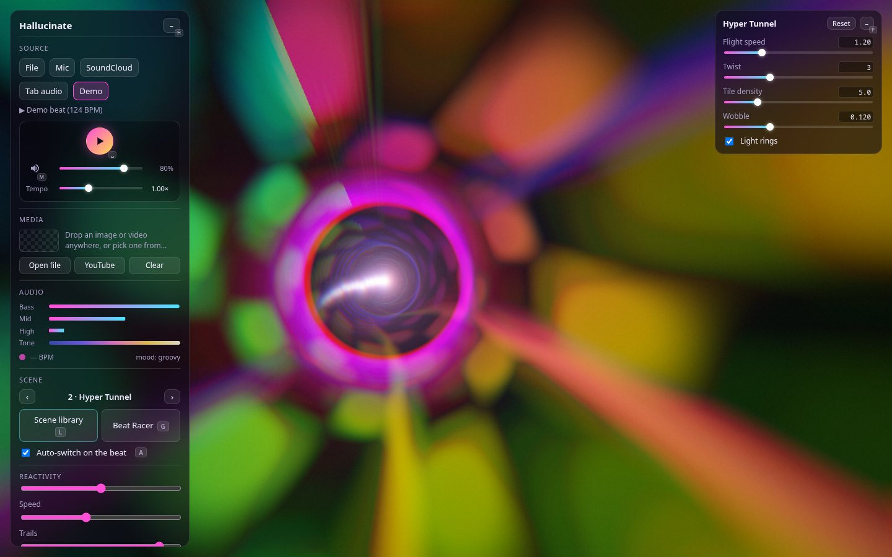

# 🪟 Interface: widgets, layout & help

[← Back to the README](../README.md)

## Widgets & layout

The controls are separate widgets: Hallucinate, Source, Media, Audio, Scene, Look, Effects, Actions, Screen and
Parameters (Screen chooses what the main screen shows; see [Studio](studio.md)). Drag one by
its title bar onto an edge of the screen to dock it there (a preview shows where it lands, and you can reorder a dock), or
drop it anywhere else to float it. Floating widgets resize by their corner, docked ones by their bottom edge, and a
dock's inner edge sets its width. Double-click a title bar to put that widget back where it started. The assistant
bubble can be dragged anywhere too, and the chat opens beside it.

**☰** shows or hides each widget and the assistant bubble, and *Reset layout* (Shift+H) restores the default
arrangement. The layout is remembered. H hides all the controls, and they also hide on their own after 3 s without
mouse movement (Settings → Interface changes the delay, or turns it off). The scene that's playing is remembered too and comes back on the next start.

The ☰ menu is also where you [export and import your setup](backup.md).

## Effects

The **Effects** widget, under the Look, reshapes the picture on the main screen before the Look does. *Add effect*
offers the effects you haven't added yet; each one then gets a row with an on/off checkbox, a × to remove it and its
settings. They run from the top of the list down, so the order changes the picture (a Wave before a Kaleidoscope
bends what gets folded; after it, it bends the mandala): drag a row by its ⠿ handle to another place, or focus the
handle and press ↑ / ↓. Show scenes keep the order. **Mirror** reflects the left half onto the right, the top half onto the bottom, or both, and holds still on
the beat. **Kaleidoscope** folds the picture into 3 to 12 segments around the centre and turns the mandala at its spin
speed; it turns faster with the bass and each kick sends it a step further on, as strongly as Reactivity says, and it
never turns back (at spin speed 0 it holds still). **Glow** lays a soft bloom of light around the lines (*Strength*: how bright, *Radius*: how far it
spreads); it swells with the bass and gives way to each kick, dipping while the lines flash and blooming back after,
so a kick never doubles it. It costs about a millisecond a frame at 1080p on an M2, the most of the effects (all four
stacked: about 3 ms, [PERF.md](../PERF.md)).
**Wave** ripples and bends the picture (*Amount* sets how far, *Wavelength* how far apart the ripples are), and on
each kick sends a ripple outward from the centre, as strongly as Reactivity says. The effects belong to
what is on screen, like the Look: they stay when the scene changes (by hand, auto-switch or the library), come back
after a reload, and show on any projector showing the main screen. Randomize and Drift leave them alone, and library
previews show scenes without them. Near the edges every effect fades back to the scene's own picture, so the border
stays as dark as the scene keeps it.

A show scene keeps its effects too ([Studio](studio.md)): *What's on Live now* and ⤓ *Update from Live* store the
screen's effects in it, and taking it with the studio open puts its effects on the screen in place of yours.

**⚙** (or **,**) opens [Settings](settings.md): how this computer renders and listens, how soon the controls hide, and
whether buttons show their key badges.

## Help

Every button with a shortcut shows its key as a small badge, and the badge lights up while you hold a modifier.
Press **?** for a sheet with every shortcut, or click the **?** next to any panel's close button for a short help
popover about that panel and the shortcuts that work there. The full list is also in [Keys](keys.md).
