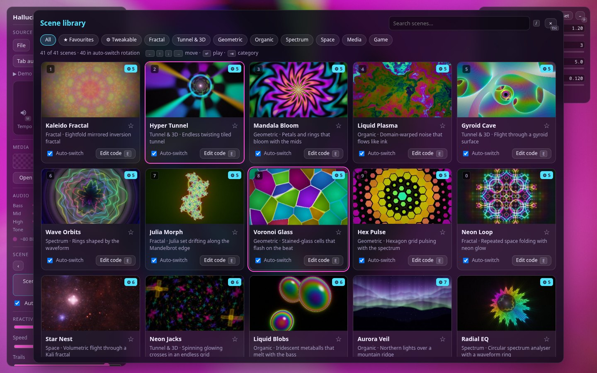

# 🎬 Scenes & the library

[← Back to the README](../README.md)

## Scenes

**There are no built-in scenes yet.** The old ones were removed to make way for a new set built for one style: a laser
show (see [ADR 0001](adr/0001-replace-all-built-in-scenes.md)). Until the first new scene ships, the app starts on
**My Shader**, and you can play the [Node Scene](visual-maker.md) and your own saved scenes (*Mine*). Built-in scenes will
come in four categories: **Beams · Geometry · Fields · Media**; the library shows a category only once it has scenes.

A show you saved that uses a removed scene keeps that show scene, marked *missing scene* in the [Studio](studio.md):
taking it only shows a message, and the autopilot and the director skip it.

With *Auto-switch* on (A), scenes crossfade every 32 detected beats (or 45 s), picking from the scenes in rotation.

## 📚 Scene library — press L

Every scene as a card with a rendered preview. Filter by category or search, then click a preview to play it.

- **★ Favourite** – favourites come up twice as often in auto-switch.
- **Auto-switch** checkbox – take a scene out of (or back into) the rotation.
- **Edit code** – opens the scene's source in the [code editor](editor.md) to remix.
- In the code editor, **Save to library** stores your shader as a scene (category *Mine*). It joins the rotation,
  survives reloads, and can be overwritten by saving under the same name or deleted from its card.
- **Doesn't compile here** – scenes that don't compile on this computer; see [Back up & move your setup](backup.md#shaders-that-dont-compile-here).

Keyboard, with the library open: `/` jumps to the search box (`Esc` leaves it, a second `Esc` closes the library),
`Tab` / `Shift+Tab` cycle the categories, `←` `↑` `↓` `→` move through the hits (also while typing), `Enter` plays the
highlighted scene, `1`–`9` and `0` play the first ten scenes (built-ins first, then yours) as everywhere else.
