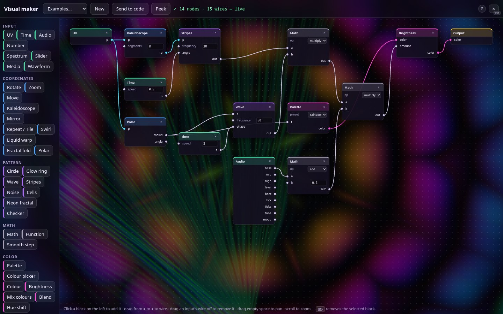

# 🧩 Visual maker — press N

[← Back to the README](../README.md)

Build scenes by wiring blocks together instead of writing code. Pick blocks from the left
(Input · Coordinates · Pattern · Math · Color), drag from an output ● to an input ● to connect them, and type
numbers straight into unconnected inputs. The result renders live behind the graph (*Peek* hides the graph).

- Wires are colour-coded by type (white = number, cyan = position, pink = colour); mismatched types are converted
  automatically.
- *Examples…* loads ready-made graphs.
- *Send to code* turns the graph into GLSL in the [code editor](editor.md) so you can keep going by hand.
- The **Slider** and **Colour picker** blocks become [live parameters](editor.md#-live-parameters--press-p).
- The **Audio** block has *tone* and *mood* outputs ([synesthesia](audio.md#-synesthesia-sound--light-mapping)); the
  **Media** block samples the dropped image or video (see the *Media warp* example).
- The **Palette** block starts on the *laser* preset (pure, fully saturated colours, like the built-in scenes);
  *rainbow*, *neon* and the others stay available, and graphs that use them keep them.
- Graphs save automatically. `Delete` or `Backspace` removes the selected block.
